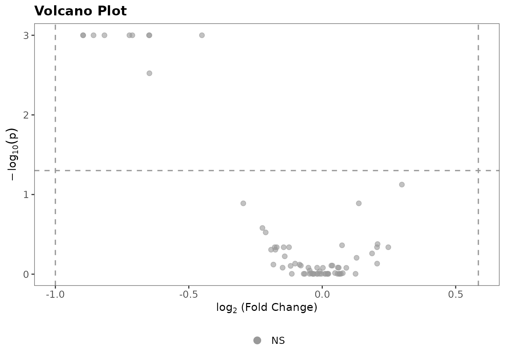
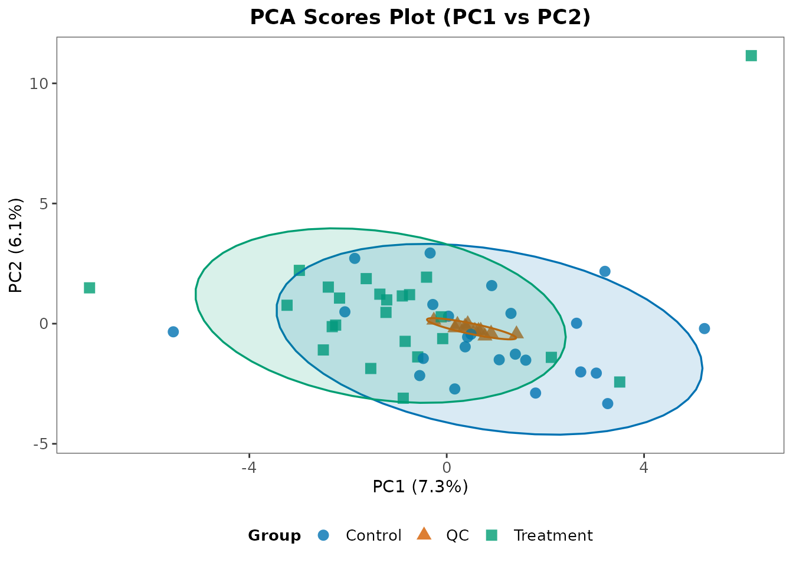
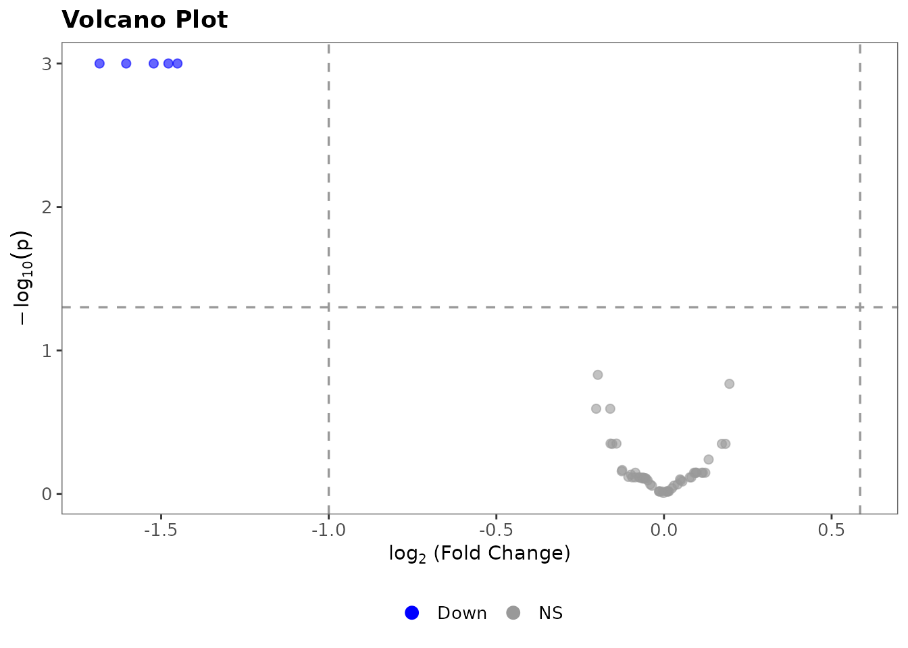
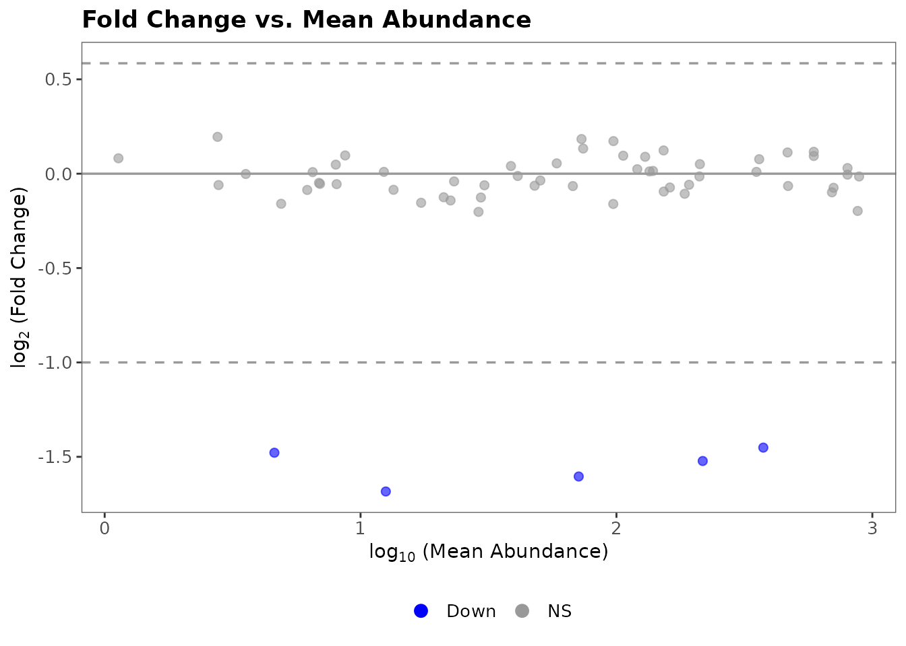
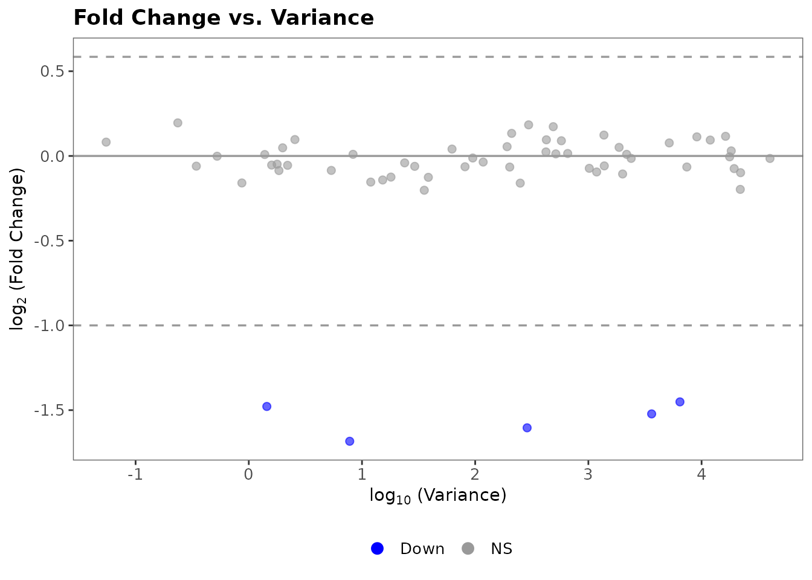
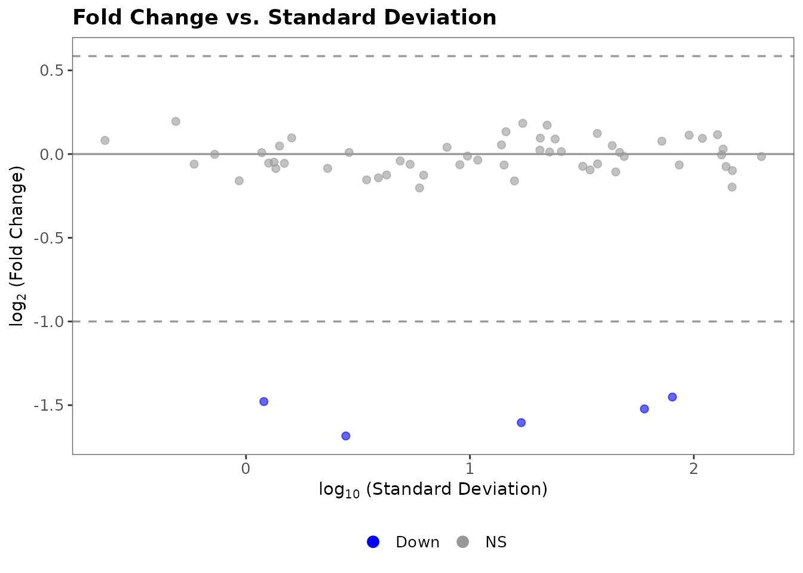
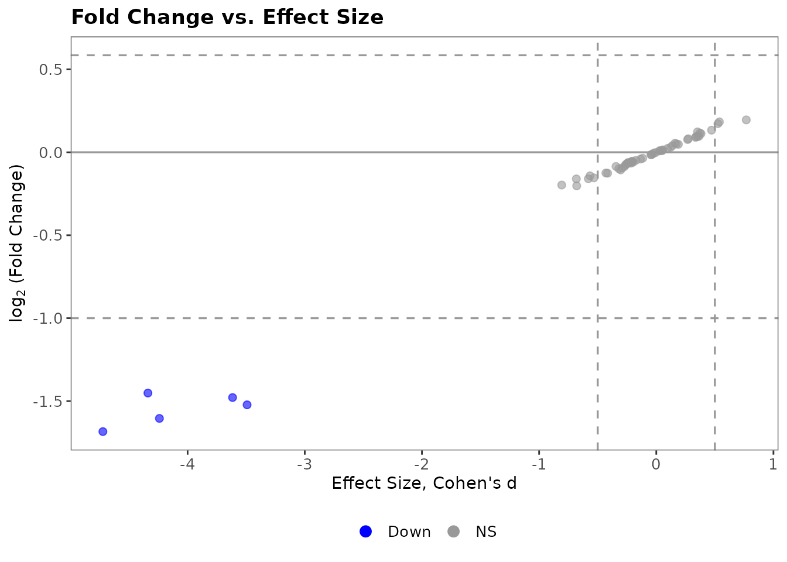
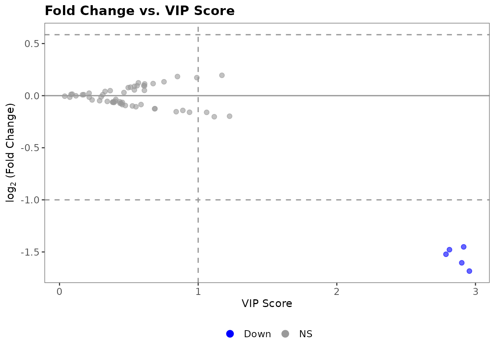
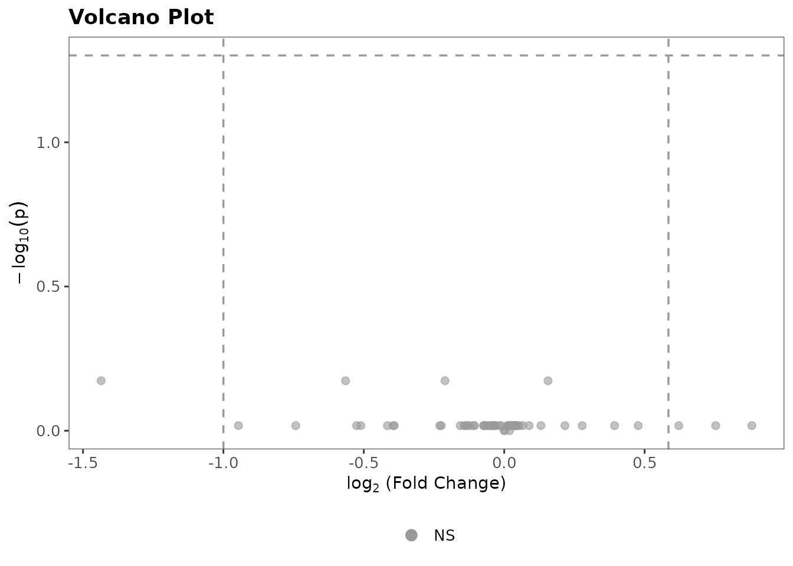
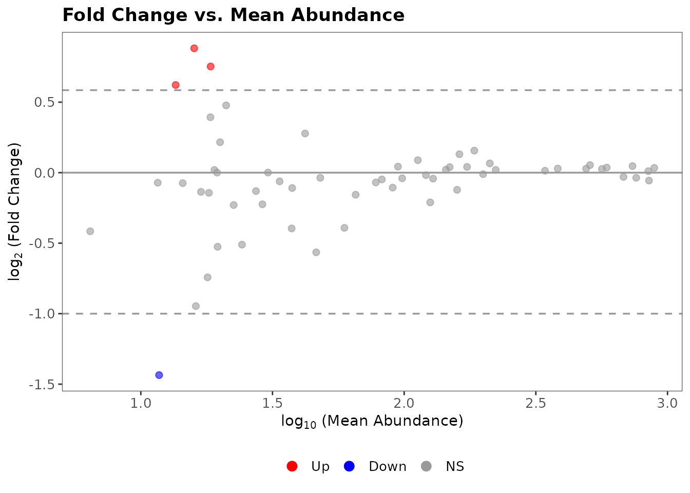

# Introduction to pondeR

``` r
library(pondeR)
```

## Tables and figures for reports

Every plot defaults to `base_size = 11`, which suits the 7 x 5 inch
figures of a default Quarto or R Markdown document. Changing `base_size`
rescales all the text in a figure. Arguments such as `title_size` and
`xlab_size` override one element.

Result tables already have report-ready column names, so they can be
printed as they are.

``` r
res <- run_diff(iris, outcome = "Sepal.Length", group = "Species")
knitr::kable(res$data_summary[c("Group", "n", "Mean", "SD")], digits = 2)
```

| Group      |   n | Mean |   SD |
|:-----------|----:|-----:|-----:|
| setosa     |  50 | 5.01 | 0.35 |
| versicolor |  50 | 5.94 | 0.52 |
| virginica  |  50 | 6.59 | 0.64 |

``` r
knitr::kable(res$posthoc_result[c("Group 1", "Group 2", "Adjusted p-value", "Significance")],
             digits = 3)
```

| Group 1    | Group 2    | Adjusted p-value | Significance |
|:-----------|:-----------|-----------------:|:-------------|
| setosa     | versicolor |                0 | \*\*\*       |
| setosa     | virginica  |                0 | \*\*\*       |
| versicolor | virginica  |                0 | \*\*\*       |

## Working with dimsprepr

pondeR accepts a
[`dimsprepr::run_DIpreprocess()`](https://jllcalorio.github.io/dimsprepr/reference/run_DIpreprocess.html)
result directly. The data, metadata, group column and QC samples are
picked up for you, and QC samples are left out of group comparisons.

``` r
di <- dimsprepr::run_DIpreprocess(dimsprepr::dims_data, dimsprepr::dims_metadata,
                                  verbose = FALSE)
di_fc   <- run_foldchange(di)
di_diff <- run_diff(di, summary_table = TRUE)
plot_volcano(list(di_fc, di_diff))$plots[[1]]
```



``` r
plot_score(run_pca(di))
```



## Fold change against significance and against other metrics

[`plot_volcano()`](https://jllcalorio.github.io/pondeR/reference/plot_volcano.md)
shows fold change against significance. When nothing is significant,
[`plot_fcmetric()`](https://jllcalorio.github.io/pondeR/reference/plot_fcmetric.md)
still shows how fold change relates to a per-feature metric. The
simulated data below have a few truly changed features and many
low-intensity features.

``` r
set.seed(2718)
n <- 40
meta <- data.frame(Group = factor(rep(c("A", "B"), each = n / 2)))
base <- 10^runif(60, 0, 3)
x <- as.data.frame(sapply(base, function(b) rnorm(n, b, 0.2 * b)))
colnames(x) <- paste0("feat_", seq_along(base))
x[meta$Group == "B", 1:5] <- x[meta$Group == "B", 1:5] * 3

fc   <- run_foldchange(x, metadata = meta, group = "Group")
diff <- run_diff(x, metadata = meta, outcome = colnames(x), group = "Group",
                 test_type = "parametric", summary_table = TRUE, verbose = FALSE)
```

### Volcano plot

``` r
plot_volcano(list(fc = fc, diff = diff))$plots[[1]]
```



### Mean abundance (MA plot)

Large fold changes at low abundance are likely noise.

``` r
plot_fcmetric(fc)$plots[[1]]
```



### Variance and standard deviation

Pooled within-group values for the two groups in each comparison.

``` r
plot_fcmetric(fc, metric = "variance")$plots[[1]]
```



``` r
plot_fcmetric(fc, metric = "sd")$plots[[1]]
```



### Effect size

Needs a multi-outcome
[`run_diff()`](https://jllcalorio.github.io/pondeR/reference/run_diff.md)
result. `x_cut` marks reference values.

``` r
plot_fcmetric(list(fc = fc, diff = diff), metric = "effect_size",
              x_cut = c(-0.5, 0.5))$plots[[1]]
```



### VIP score

Needs a
[`run_pls()`](https://jllcalorio.github.io/pondeR/reference/run_pls.md)
result (PLS-DA or OPLS-DA) and the suggested package `ropls`.

``` r
pls <- run_pls(scale(x), metadata = meta, group = "Group", method = "plsda",
               crossvalI = 5, permI = 0, verbose = FALSE)
```

``` r
plot_fcmetric(list(fc = fc, pls = pls), metric = "vip", x_cut = 1)$plots[[1]]
```



### When nothing is significant

Here the groups do not differ, but measurement noise is roughly
constant, so low-abundance features still show large fold changes. The
volcano plot cannot tell these apart from real effects. It shows only
non-significant points.
[`plot_fcmetric()`](https://jllcalorio.github.io/pondeR/reference/plot_fcmetric.md)
shows that the large fold changes sit at low abundance.

``` r
set.seed(5309)
x0 <- as.data.frame(sapply(base, function(b) pmax(rnorm(n, b, 30 + 0.05 * b), 0.5)))
colnames(x0) <- colnames(x)

fc0   <- run_foldchange(x0, metadata = meta, group = "Group")
diff0 <- run_diff(x0, metadata = meta, outcome = colnames(x0), group = "Group",
                  test_type = "parametric", summary_table = TRUE, verbose = FALSE)
```

``` r
plot_volcano(list(fc = fc0, diff = diff0))$plots[[1]]
```



``` r
plot_fcmetric(fc0)$plots[[1]]
```


